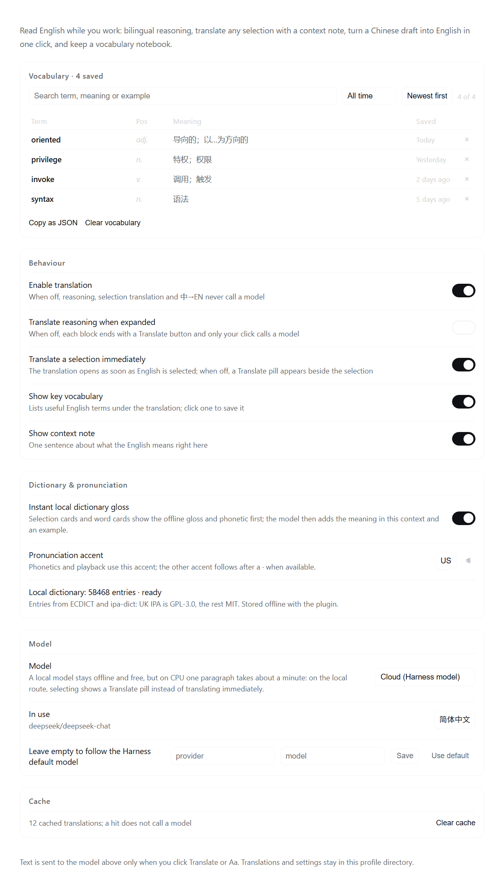

# DSH-Translate

<p align="center"></p>

<p align="center"><b>English translation and learning for DeepSeek Harness</b><br>
Bilingual reasoning, instant selection translation with an offline dictionary, pronunciation, composer polish, and a vocabulary notebook.</p>

<p align="center"><a href="README_zh.md">中文说明</a> · <a href="data/README.md">Dictionary data</a> · <a href="THIRD-PARTY-NOTICES.md">Third-party notices</a></p>

A persistent DeepSeek Harness Web plugin: read English while you work. Translate reasoning blocks part by part, look up any selected word instantly (no model round trip), hear how it is pronounced, turn a Chinese draft into English in place, and save the words worth keeping.



*The plugin's settings section: vocabulary notebook, behaviour, dictionary & pronunciation, model route and cache. Screenshot rendered from the real UI component with sample data.*

## Features

| Where | What you get |
| --- | --- |
| Reasoning blocks | Open any reasoning block → click **Translate** at the end → Chinese translation, a context note and 3–6 key-vocabulary chips below the English. Manual by default; enable auto-translate in Settings. **Long blocks translate chunk by chunk** (~2400 characters each): the translation grows as parts arrive with a `x/y` progress label, can be stopped at any time, and resumes from the first unfinished part after a stop or a failed part. |
| Selection | With the cloud engine, **selecting English opens a card automatically**: the top of the card shows the **offline dictionary gloss and phonetic first, without waiting for the model**; the model result then adds the meaning in context, a context note and vocabulary chips. Close or retry at any time. On the local engine the card waits for a **Translate** click (CPU inference is slow); auto-translate can also be turned off in Settings. |
| Context menu | Select English and right-click → **Translate selection** / **Copy selection**. |
| Dictionary | The plugin bundles a 58,468-entry English–Chinese dictionary (ECDICT + ipa-dict; the data file is GPL-3.0, see [License](#license)): a single word or a 2–4 word selection shows Chinese senses, US/UK IPA and a pronunciation button immediately. Fully local: no model call, no network. Can be switched off in Settings. |
| Pronunciation | Every word card, vocabulary chip and notebook entry has a 🔊 button: US/UK human audio from Youdao's dictionary audio; if it fails or the network is unavailable, playback falls back to the browser's `speechSynthesis` after 4.5 s. The IPA follows the accent chosen in Settings; the other accent is appended after a `·`. A preview button is in Settings. |
| Composer 中→EN | Type a Chinese draft and a **中→EN** button appears on the right; click it to replace the draft with English (code, paths and identifiers preserved) plus 0–3 rewrite notes and an **Undo**. |
| Vocabulary notebook | Click any term in a translation card to save it. The first group of the settings page is the notebook: search (term / part of speech / meaning / example), time filter (all / today / last 7 days / last 30 days), sort (newest / oldest / A–Z), and a table of term · pos · meaning · saved time with keyword highlighting. **Click a row to expand its word card in place** (IPA, pronunciation, dictionary senses, then meaning → usage → collocations → example; explained automatically on the cloud engine, on demand on the local engine). Delete one entry, copy the filtered list, or clear the notebook; the settings nav shows the entry count. |

UI text follows the DSH language setting (Chinese / English). All styling uses the host theme variables; the translation card is anchored next to the selection and does not cover the composer.

## Long reasoning blocks

- The browser half requests a long reasoning block one ~2400-character part at a time. Each part gets its own model call and its own timeout (60 s cloud / 180 s local) instead of one shared budget, so a slow part no longer hides the whole translation.
- Each finished part is appended immediately and the card shows `x/y` progress. **Stop** keeps what was already translated; **Continue** resumes from the first unfinished part. A failed part keeps the finished parts and offers Retry.
- Parts are cached per chunk (`cache.json`), so stopping, failing or collapsing the block never re-translates finished parts.
- Reasoning translation is no longer truncated by `maxChars` (the old default 8000). The only hard limit is 60,000 characters per request, and hitting it is reported instead of silently truncating. Selection translation still travels as one request (a very long selection is split internally, and a mid-way failure is marked partial).

## Dictionary and pronunciation

- **Bundled dictionary**: `data/dictionary.json.gz` is about 1.9 MB with 58,468 entries and 32,888 inflected-form lookups (ran→run, mice→mouse, went→go). It ships with the plugin — nothing is downloaded at runtime and no network is needed. Chinese senses come from [ECDICT](https://github.com/skywind3000/ECDICT) (MIT); IPA comes from [ipa-dict](https://github.com/open-dict-data/ipa-dict): the American data is MIT and the British data is GPL-3.0 (it derives from ipacards), which is why the bundled data file as a whole is GPL-3.0. The payload is generated by `scripts/build-dictionary.mjs`; format, attribution and licences are in [data/README.md](data/README.md) and [THIRD-PARTY-NOTICES.md](THIRD-PARTY-NOTICES.md).
- The dictionary gloss is only a first look: when the model answers, it still adds the meaning that fits the current context, a context note and an example. The two paths load in parallel and never overwrite each other.
- **Pronunciation**: a few-KB mp3 per word is fetched from Youdao's `dictvoice` endpoint on click or hover (the word never passes through the plugin backend); on failure or offline the browser voices take over. If neither is available, the IPA stays visible.
- Settings → **Dictionary & pronunciation**: instant local gloss switch, accent (US / UK) with a preview button, and the dictionary status (entry count / not installed).

## Models and privacy

- Only text you act on is sent to a model: the text you click Translate or 中→EN for, and — with instant selection translation on (the default on the cloud engine) — the English you select. Reasoning blocks are not translated automatically by default.
- Dictionary lookups read only the local `data/dictionary.json.gz`: no model call, nothing leaves the machine. Pronunciation requests that word's public audio from Youdao only when you click or hover the button; speech synthesis is fully offline.
- **Translation engine** (Settings → Model):
  - `Cloud (Harness model)` — default; follows the Harness default model and answers in seconds;
  - `Local Ollama` — fully offline, free, but slow on CPU only (see below); selecting falls back to the Translate button instead of auto-translating;
  - `Local first, cloud on failure`.
- Cloud requests pick the model's cheapest reasoning effort (off/none/minimal/low) so a translation does not spend the highest reasoning budget.

### Local models

Local Ollama keeps text on the machine and costs nothing, but with CPU-only inference (no CUDA/ROCm acceleration) a small 1–4B model is a "one paragraph per minute" experience and its resident memory can slow the whole machine. Pull a 1.5B–4B instruct model and pick `Local Ollama` in Settings; the plugin sets the local model's `keep_alive` to 30 s so memory is released soon after use.

Translation cache and vocabulary live under the DSH profile directory in `dsh-translate/` (`cache.json`, `vocab.json`, `settings.json`, owner-readable only). A cache hit never calls the model. The plugin does not read or write session events; translations are a display-layer cache.

## Structure

```
index.js             Host entry: optional llm / agentDefaultModel injection, /dsh-translate/api routes, dictionary warm-up
lib/routes.js        Same-origin JSON API (state / settings / translate / polish / vocab / dictionary / local / cache); two translate modes: chunked and one-shot
lib/dictionary.js    Bundled dictionary: decompress + index data/dictionary.json.gz, exact → inflected form → morphology
lib/model.js         Route choice: local Ollama or the Harness LLM stream
lib/local.js         Ollama client (/api/tags, /api/chat, keep_alive)
lib/prompt.js        Prompts for translation + explanation, per-part translation and 中→EN rewriting
lib/parse.js         Tolerant JSON parsing, term normalisation, chunking and the deterministic `planChunks` plan
lib/cache.js         LRU translation cache (memory + profile file)
lib/store.js         JSON store for settings and vocabulary (0600, temp file + rename)
client.js            Browser half: reasoning body and per-part rendering, selection overlay + context menu, dictionary gloss and pronunciation, composer Aa, settings page
data/                Bundled dictionary payload and source notes (data/README.md)
docs/images/         README screenshots (settings page, en + zh)
scripts/             Developer tools: build-dictionary.mjs rebuilds the bundled dictionary
locale/*.json        Plugin Manager title and description
assets/icon.png      Plugin icon (Plugin Manager and marketplace)
tmp/                 Scratch space for development (not packaged)
```

## Install / uninstall

Requirements: DeepSeek Harness `0.2.1-rc.5` or newer (developed on `0.2.2-rc.1`), on **Windows, macOS or Linux**. The DSH desktop app ships its own Node.js runtime, so nothing else is needed to use the plugin; Node.js 22+ is only required when you build or test it from source.

- **Plugin Manager**: install **DSH-Translate** from the marketplace, or add the package `@lightcheng/dsh-translate` to your profile, then restart DSH.
- **npm**: `dsh plugin --profile <profile> add @lightcheng/dsh-translate`.
- **From source** (a directory install links the checkout: refresh the page after editing `client.js`; restart DSH after editing `lib/*`):
  ```
  dsh plugin --profile <profile> add <absolute path to this directory>
  ```

Uninstall from the Plugin Manager, or remove the dependency from the profile's `package.json` / `cordis.patch.yml`. Uninstalling restores the official rendering; the plugin never modifies DSH files. Your settings, cache and notebook stay in `<DSH profile>/dsh-translate/` unless you delete that folder.

## Development

```
npm run check            # node --check for every entry, module and build script
npm test                 # node --test test/
npm run build:dict       # optional: rebuild data/dictionary.json.gz (needs network; caches to tmp/)
```

`test/routes.translate.test.mjs` drives both `/translate` modes through a fake Harness model (chunk protocol, `part`/`next`, per-part cache, a failed part keeping the others, no truncation, 60k limit); `test/parse.test.mjs` covers `planChunks` determinism and full coverage. Neither test uses the network or a real model. `test/dictionary-data.test.mjs` validates the shipped payload.

`client.js` is a prebuilt single-file dynamic module (`window.__ModuleLoader__.load`) with no bundler; refresh the page to load new code. Host-side changes (`index.js`, `lib/*`) are loaded when DSH starts: restart DSH to apply them (a page refresh only reloads `client.js`).

## License

- **Plugin code**: MIT — see [LICENSE](LICENSE).
- **Bundled dictionary data** (`data/`): **GPL-3.0-only**. The British IPA data derives from [ipacards](https://github.com/leoboiko/ipacards) (GPL-3.0), so the generated data file as a whole ships under GPL-3.0. The full text is in [LICENSES/GPL-3.0.txt](LICENSES/GPL-3.0.txt); per-source attribution, the list of modifications and the corresponding source are in [THIRD-PARTY-NOTICES.md](THIRD-PARTY-NOTICES.md) and [data/README.md](data/README.md).
- Upstream datasets: ECDICT (MIT, © 2025 Linwei), ipa-dict `en_US` (MIT, © 2016 dohliam, based on cmudict-ipa) and ipa-dict `en_UK` (GPL-3.0, based on ipacards).

Issues and feature requests: <https://github.com/light-cheng/DSH-Translate/issues>.
