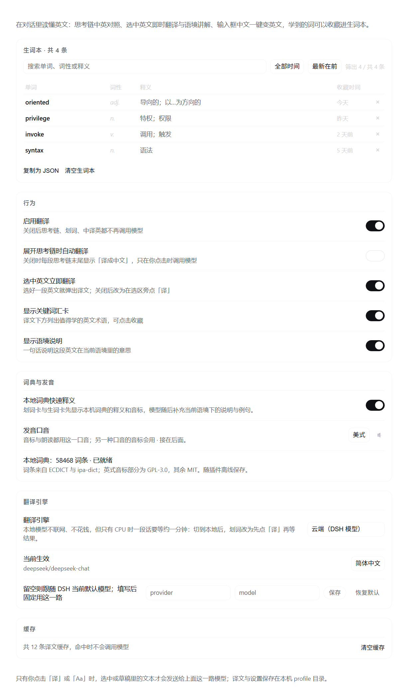

# DSH-Translate · 英语翻译与学习

<p align="center"></p>

<p align="center"><b>DeepSeek Harness 的英语翻译与学习插件</b><br>
思考链中英对照、划词即时翻译（先看本地词典）、真人发音、输入框润色，以及生词本。</p>

<p align="center"><a href="README.md">English README</a> · <a href="data/README.md">词典数据</a> · <a href="THIRD-PARTY-NOTICES.md">第三方声明</a></p>

在 DSH Web 界面里边写代码边读英文：思考链逐段翻译、划词先秒查内置词典再等模型补语境、听真人发音、把中文草稿一键换成英文，并把值得学的词收进生词本。



*插件设置页：生词本、行为、词典与发音、翻译引擎与缓存。截图由真实 UI 组件配合示例数据渲染。*

## 功能

| 位置 | 用法 |
| --- | --- |
| 思考链 | 展开任一段思考链 → 末尾点「译成中文」→ 原文下方出现中文译文、语境说明、3–6 张关键词汇卡。默认手动触发，可在设置里改成展开即翻译。**长思考链逐段翻译**（约 2400 字符一段）：译文边译边显示，进度「已译 x/y 段…」；可随时「停止」，停下或某段失败后保留已译内容并可「继续翻译」。 |
| 划词 | 云端模式下**选中英文就自动翻译**：选区旁直接浮出译文卡片，**卡片顶部先给本地词典释义与音标，不用等模型**；模型结果随后补当前语境下的释义、语境说明与词汇卡。可关闭、可重译。切到本地模型时改为选区旁点「译」（纯 CPU 推理较慢，不适合自动触发）；设置里也可手动关掉「选中英文立即翻译」。 |
| 右键 | 选中英文后右键 → 菜单里直接有「翻译选中」「复制选中」。 |
| 词典 | 插件自带 58,468 词条英汉词典（ECDICT + ipa-dict，数据文件为 GPL-3.0，见 [License](#license)）：选中的单词或 2–4 词短语立即显示中文释义、美/英音标与发音按钮。完全在本机查词，不调用模型、不联网；设置里可关闭。 |
| 发音 | 划词词卡、译文里的关键词汇 chips、生词本单词卡都带 🔊：点一下播放美式/英式真人发音（取自有道词典音频）；断网或加载失败 4.5 秒后自动回落到浏览器语音合成。音标随设置显示所选口音，另一种口音用 `·` 接在后面；设置页有试听按钮。 |
| 输入框中译英 | 输入框里写了中文时，右侧出现「中→英」→ 点一下直接换成英文（保留代码、路径、标识符），并在卡片里给出 0–3 条改写说明，可「撤销」回到中文。 |
| 生词本 | 译文卡片里点任意词汇即收藏。设置页「DSH-Translate」第一组就是生词本：搜索框（单词/词性/释义/例句）、时间筛选（全部 / 今天 / 近 7 天 / 近 30 天）、排序（最新 / 最早 / 按字母），下面是「单词 · 词性 · 释义 · 收藏时间」表格，命中关键词高亮；**点某一行就在行下方展开单词卡**（音标 + 发音 + 词库释义 + 释义 → 用法 → 搭配 → 例句，云端自动讲解、本地手动点「讲解这个词」），可单条删除、复制（跟随当前筛选）或清空；导航标题直接显示条数。 |

界面文本跟随 DSH 语言设置（中文 / English），配色只用宿主主题变量；译文卡片定位在选区旁，不占用输入框区域。

## 长文本与思考链

- 浏览器半边按约 2400 字符一段依次请求思考链长文：每段一次模型调用、各自独立的超时（云端 60 秒 / 本地 180 秒），不再共用一个总预算，因此不会出现「翻到一半整体超时、一个字都不显示」。
- 每段译文返回后立刻追加到卡片里，进度显示「已译 x/y 段…」；中途可「停止」，已译内容保留，之后「继续翻译」从未完成的段接着来。某一段模型报错时同样保留已译段落并给出「重试」。
- 译文按段缓存（`cache.json`）：停止/失败/折叠展开后重试只会补没翻过的段，不会重复调用模型。
- 思考链翻译不再按设置里的 `maxChars`（旧默认 8000）截断原文；唯一硬上限是单次 6 万字符，超出会明确提示，而不是静默截断。划词翻译仍是一次请求返回完整结果（超长划词会在内部按段处理，中途失败会标注「部分翻译」）。

## 词典与发音

- **内置词典**：`data/dictionary.json.gz` 约 1.9 MB，58,468 个词条 + 32,888 条屈折形式反查（ran→run、mice→mouse、went→go），随插件一起安装，**不需要运行时下载**，也不用联网。中文释义来自 [ECDICT](https://github.com/skywind3000/ECDICT)（MIT）；音标来自 [ipa-dict](https://github.com/open-dict-data/ipa-dict)：美式是 MIT，英式是 GPL-3.0（派生自 ipacards），因此整个词典数据文件按 GPL-3.0 分发。数据由 `scripts/build-dictionary.mjs` 生成，格式、归属与许可见 [data/README.md](data/README.md) 与 [THIRD-PARTY-NOTICES.md](THIRD-PARTY-NOTICES.md)。
- 词典释义只是「先看一眼」：模型返回后仍按语境给出更贴切的释义、说明与例句，两条路径并行加载、互不覆盖。
- **发音**：真人音频按需从有道词典 `dictvoice` 拉取一个几 KB 的 mp3（点按或悬停发音按钮时请求；词条本身不经过插件后端），失败或断网时回落到浏览器 `speechSynthesis`（无需安装语音包）。两种方式都不可用时音标仍然显示。
- 设置页「词典与发音」：本地词典快速释义开关、发音口音（美式/英式）与试听、以及词典状态（词条数 / 未安装）。

## 模型与隐私

- 只有你操作的文本才会发送给模型：点击「译」或「中→英」的文本，以及（云端引擎下默认开启的）选中英文时的选中内容；思考链默认不自动翻译。
- 内置词典查询只读本机 `data/dictionary.json.gz`，不调用模型、不出本机。发音只在点按/悬停发音按钮时向有道词典请求该词的公开音频，不发原文段落；系统语音合成完全离线。
- **翻译引擎**（设置页「翻译引擎」）：
  - `云端（DSH 模型）` **默认**，跟随 DSH 当前默认模型，秒级返回；
  - `本地 Ollama` 完全本机、不联网、不花钱，但纯 CPU 推理时较慢（见下），选中后划词改为点「译」而不是自动翻译；
  - `本地优先，失败回落云端` 本地调不通时自动用云端。
- 云端请求会为该模型挑最省的一档推理（off/none/minimal/low），避免用最高推理档慢慢翻一段话。

### 本地模型

本地 Ollama 可以让文本不离开本机、也不花钱，但没有 CUDA / ROCm 加速时，1.5B–4B 的小模型只能纯 CPU 推理，大致是「一分钟一段话」的量级，且常驻会占用几 GB 内存、拖慢整机。准备好本地模型（如 `qwen2.5:3b-instruct`）后在设置页选择 `本地 Ollama` 即可；插件把本地模型的 `keep_alive` 设为 30 秒，用完很快释放内存。

译文缓存与生词本保存在 DSH profile 目录下的 `dsh-translate/`（`cache.json`、`vocab.json`、`settings.json`，仅本人可读）。命中缓存不会再次调用模型。插件不读取、不写入任何会话事件；译文只是显示层缓存。

## 结构

```
index.js             Host 入口：可选注入 llm / agentDefaultModel，注册 /dsh-translate/api 路由，预热内置词典
lib/routes.js        同源 JSON 接口（state / settings / translate / polish / vocab / dictionary / local / cache）；translate 有「按段增量」与「整段一次」两种模式
lib/dictionary.js    内置词典：解压索引 data/dictionary.json.gz，精确 → 屈折反查 → 词形还原
lib/model.js         路由选择：本地 Ollama 或 Harness llm 流
lib/local.js         Ollama 客户端（/api/tags 列模型、/api/chat 出结果、keep_alive 保模型常驻）
lib/prompt.js        译文+讲解、按段译文、润色的 JSON 输出提示词
lib/parse.js         JSON 容错解析、术语规范化、长文分块，以及按段翻译的全量分块计划 planChunks
lib/cache.js         LRU 译文缓存（内存 + profile 文件）
lib/store.js         设置与生词本的 JSON 存储（0600、临时文件 + rename）
client.js            浏览器半边：思考链正文与逐段译文、划词浮层与右键菜单、词典快速释义与发音、输入框 Aa、设置页
data/                内置词典产物与来源说明（data/README.md）
docs/images/         README 截图（中英设置页）
scripts/             开发工具：build-dictionary.mjs 重建内置词典
locale/*.json        Plugin Manager 显示用的标题与描述
assets/icon.png      插件图标（插件管理器与市场用）
tmp/                 开发用临时目录（不入包）
```

## 安装 / 卸载

要求：DeepSeek Harness `0.2.1-rc.5` 或更新（开发与验证用的是 `0.2.2-rc.1`），Node.js 22+。

- **插件管理器**：在市场里安装 **DSH-Translate**，或把 `@lightcheng/dsh-translate` 加进 profile，然后重启 DSH。
- **npm**：`dsh plugin --profile <profile> add @lightcheng/dsh-translate`。
- **从源码安装**（目录安装会链接当前工作区；改动 `client.js` 后刷新页面即可，改动 Host 侧 `lib/*` 后需重启 DSH 才生效）：
  ```
  dsh plugin --profile <profile> add <本目录绝对路径>
  ```

卸载：在插件管理器里移除，或从 profile 的 `package.json` / `cordis.patch.yml` 里删掉对应依赖。卸载后原文渲染回归官方实现，本插件不修改 DSH 任何文件。设置、缓存与生词本仍留在 `<DSH profile>/dsh-translate/`，除非你手动删掉这个目录。

## 开发

```
npm run check            # node --check 全部入口/模块/构建脚本
npm test                 # node --test test/
npm run build:dict       # 可选：重建 data/dictionary.json.gz（需联网，缓存到 tmp/）
```

`test/routes.translate.test.mjs` 用假的 Harness 模型把 `/translate` 的两种模式跑一遍（按段协议、`part`/`next`、按段缓存、单段失败不丢其他段、整段不截断、6 万字符上限）；`test/parse.test.mjs` 覆盖 `planChunks` 的完整覆盖与确定性；两者都不联网、不调用真实模型。`test/dictionary-data.test.mjs` 校验随包词典产物。

`client.js` 是预构建的单文件动态模块（`window.__ModuleLoader__.load`），不经打包器；改动后刷新页面加载新代码。Host 侧（`index.js`、`lib/*`）代码只在 DSH 启动时加载，需重启 DSH 才生效（只刷新页面只会更新 `client.js`）。

## License

- **插件代码**：MIT，见 [LICENSE](LICENSE)。
- **内置词典数据**（`data/`）：**GPL-3.0-only**。英式音标派生自 [ipacards](https://github.com/leoboiko/ipacards)（GPL-3.0），所以生成的数据文件整体按 GPL-3.0 分发；全文见 [LICENSES/GPL-3.0.txt](LICENSES/GPL-3.0.txt)，逐项归属、修改说明与「对应源代码」见 [THIRD-PARTY-NOTICES.md](THIRD-PARTY-NOTICES.md) 与 [data/README.md](data/README.md)。
- 上游数据集：ECDICT（MIT，© 2025 Linwei）、ipa-dict `en_US`（MIT，© 2016 dohliam，派生自 cmudict-ipa）、ipa-dict `en_UK`（GPL-3.0，派生自 ipacards）。

问题与建议：<https://github.com/light-cheng/DSH-Translate/issues>。
